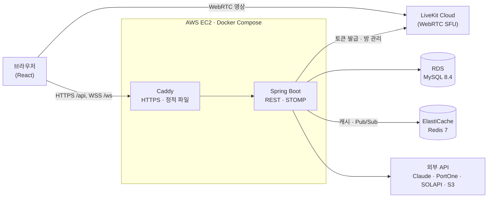

# 땅땅땅 (DDangDDangDDang)

> 판매자가 방송을 켜고, 시청자가 영상을 보며 실시간으로 입찰하는 **라이브 경매 플랫폼**

🔗 서비스: https://ddangddangddang.com

<br>

## 목차

- [소개](#소개)
- [주요 기능](#주요-기능)
- [기술 스택](#기술-스택)
- [아키텍처](#아키텍처)
- [기술적 의사 결정](#기술적-의사-결정)
- [프로젝트 구조](#프로젝트-구조)
- [로컬 실행](#로컬-실행)
- [테스트](#테스트)
- [배포](#배포)
- [문서](#문서)

<br>

## 소개

온라인 경매는 사진 몇 장과 설명만 보고 입찰해야 해서, 물건 상태를 믿기 어렵습니다.
**땅땅땅**은 판매자가 물건을 방송으로 직접 보여 주고, 시청자는 채팅으로 묻고 바로 입찰합니다.

- 방송 화면 위에 진행 중인 경매와 현재가가 실시간으로 올라옵니다.
- 낙찰 금액은 포인트로 **에스크로**에 묶였다가, 구매자가 구매를 확정하면 판매자에게 넘어갑니다.
- 채팅은 AI가 검토해 외부 거래 유도, 욕설, 사기성 메시지를 판매자에게 알리거나 자동으로 가립니다.

<br>

## 주요 기능

### 🎥 라이브 방송
- WebRTC(LiveKit) 기반 저지연 방송, 판매자 방송 스튜디오
- 방송 썸네일·오버레이 이미지·대표 경매 지정
- 시청자 수 통계, 30분 동안 송출이 없으면 경고 후 자동 종료
- 녹화 영상을 반복 재생하는 **라이브 봇** 방송 (관리자 운영)

### 🔨 경매 · 입찰
- 일반 경매와 방송 중 경매, 즉시 구매
- 비관적 락 + 재시도로 동시 입찰에서도 현재가 정합성 보장
- 입찰·종료 소식을 STOMP로 실시간 전달
- 인기 경매, 판매자별 경매, 경매 알림 신청

### 💬 채팅 · 메시지
- 방송 채팅: 도배 제한, 금칙어 필터, 반복 메시지 차단
- **AI 채팅 검토**(Claude API): 끄기 / 알림 / 자동 가림 모드, 가린 메시지 복원
- 1:1 메시지(DM): 읽음 처리, 신고, AI 검토

### 💰 포인트 · 주문
- 포트원(PortOne) 결제로 포인트 충전, 웹훅 검증, 출금 신청
- 낙찰 → 에스크로 → 발송 → 구매 확정 / 취소·환불 흐름
- 배송 조회, 발송 지연 요청, 문제 신고, 판매 수수료 정책
- 리뷰와 판매자 답글

### 🎁 후원 · 마일리지 · 상점
- 방송 중 판매자에게 도네이션 포인트 선물 (중복 요청 방지)
- 마일리지 적립·유효기간, 상점(닉네임 변경, 경매 위로 올리기, 파워 셀러, 뱃지)

### 👤 회원 · 판매자
- 이메일·휴대폰 인증 가입, 카카오·구글 로그인, JWT 인증
- 판매자 신청·본인 확인·관리자 승인, 판매자 구독
- **망치 등급**: 최근 12개월 거래·리뷰로 계산하는 거래 신뢰도
- 알림(실시간 + 웹 푸시), 알림 종류별 설정

### 🛠 운영
- 카테고리·배너 광고·판매자 승인·제재 해제 관리

<br>

## 기술 스택

| 분류 | 기술 |
| --- | --- |
| Language | Java 17, TypeScript |
| Backend | Spring Boot 4.1, Spring Data JPA, QueryDSL 7.0, Spring WebSocket(STOMP), springdoc-openapi |
| Security | Spring Security, JWT(jjwt), OAuth 2.0(카카오·구글) |
| Database | MySQL 8.4, Redis 7 |
| Message Broker | STOMP Simple Broker + Redis Pub/Sub |
| Realtime Media | LiveKit (WebRTC SFU) |
| Frontend | React 19, Vite, Tailwind CSS 4, TanStack Query, React Router 7 |
| Test | JUnit 5, Spring Boot Test, Testcontainers, Vitest, Playwright, k6 |
| Monitoring | Spring Actuator, Micrometer, Prometheus, Grafana |
| Infra | AWS (EC2, RDS, ElastiCache, S3, ECR, Secrets Manager, Route 53), Docker Compose, Caddy, Terraform |
| CI/CD | GitHub Actions (OIDC → ECR → SSM 배포) |
| Open API | Claude API, PortOne, LiveKit Cloud, SOLAPI(SMS), Gmail SMTP, 배송 조회 API, Web Push(VAPID) |
| Collaboration | GitHub, Notion, CodeRabbit |

<br>

## 아키텍처



- 영상은 브라우저와 LiveKit이 직접 주고받고, 서버는 **입장 토큰 발급과 방 관리**만 합니다.
- 입찰·채팅·알림 같은 실시간 메시지는 STOMP로 보내고, 서버가 여러 대여도 모든 구독자에게 닿도록 **Redis Pub/Sub**으로 서버끼리 전달합니다.
- 배포는 EC2 한 대 구성으로 운영 중입니다. 같은 Terraform 코드에 **ECS Fargate + ALB** 구성도 있지만, 지금은 API만 제공합니다. 전환하려면 화면을 제공할 웹 이미지나 정적 호스팅을 먼저 추가해야 합니다. ([docs/deploy.md](docs/deploy.md))

<br>

## 기술적 의사 결정

| 주제 | 결정 | 이유 |
| --- | --- | --- |
| 라이브 방송 | LiveKit Cloud (WebRTC) | RTMP+HLS는 지연이 수 초라 입찰에 맞지 않고, SFU를 직접 운영할 여력이 없었습니다. |
| 실시간 메시지 | STOMP Simple Broker + Redis Pub/Sub | 이미 쓰는 Redis로 서버 간 전달을 해결해, Kafka·RabbitMQ를 새로 운영하지 않았습니다. |
| 동시 입찰 | 비관적 락 + 재시도 | 한 경매에 입찰이 몰려도 현재가가 어긋나지 않게 했습니다. |
| AI 채팅 검토 | 규칙 필터(동기) + AI 검토(비동기) 분리 | AI 응답을 기다리지 않아 채팅이 느려지지 않고, AI가 멈춰도 채팅은 계속됩니다. |
| 거래 안전 | 포인트 에스크로 | 구매 확정 전까지 판매자에게 돈이 넘어가지 않습니다. |

<br>

## 프로젝트 구조

```
.
├── src/main/java/com/example/ddangddangddang
│   ├── domain          # 기능별 패키지 (controller · service · repository · entity · dto)
│   │   ├── auction         경매 · 입찰
│   │   ├── livestream      라이브 방송 · LiveKit 연동
│   │   ├── livechat        방송 채팅 · AI 검토
│   │   ├── livebot         녹화 영상 봇 방송
│   │   ├── directmessage   1:1 메시지
│   │   ├── order           주문 · 에스크로 · 배송 · 수수료
│   │   ├── point           포인트 충전 · 출금 (PortOne)
│   │   ├── donation        후원 · 마일리지
│   │   ├── shop            마일리지 상점
│   │   ├── review          리뷰
│   │   ├── hammer          망치 등급 · 제재
│   │   ├── seller          판매자 신청 · 구독
│   │   ├── notification    알림 · 웹 푸시
│   │   ├── auth · user     인증 · 회원
│   │   └── product · category · address · ad
│   └── global          # 보안, WebSocket, 결제, 저장소(S3), 공통 응답·예외
├── frontend            # 서비스 화면 (React)
├── test-client         # 개발 확인용 화면
├── infra               # Terraform (AWS 전체)
├── load-test           # k6 시나리오 · Prometheus/Grafana · 측정 보고서
└── docs                # 배포 가이드, API 명세, 마이그레이션 SQL
```

<br>

## 로컬 실행

**준비물**: JDK 17, Node.js 24 (CI와 같은 버전, 최소 20.19), Docker

```bash
# 1. MySQL · Redis · LiveKit 실행 (터미널 1, 저장소 루트에서)
docker compose up -d
```

```bash
# 2. 백엔드 실행 (터미널 1, 저장소 루트에서. 켜 둔 채로 둡니다) → http://localhost:8080
./gradlew bootRun
```

```bash
# 3. 프론트엔드 실행 (터미널 2, 저장소 루트에서) → http://localhost:5173
cd frontend
npm install
npm run dev
```

- 기본 설정만으로 회원가입, 경매 둘러보기, 채팅을 쓸 수 있습니다. (LiveKit은 Docker의 개발 모드로 실행)
- **방송을 열려면 승인된 판매자 계정**이 필요합니다. 판매자 신청 전에 본인인증을 해야 하고(기본은 PortOne 본인인증. 로컬에서는 `seller.identity.provider=fake`로 가짜 인증을 쓸 수 있음), 신청은 관리자가 승인합니다. 로컬에서 관리자 계정을 만들려면 백엔드를 켜기 전에 `DEV_ADMIN_EMAIL`, `DEV_ADMIN_PASSWORD`를 설정하세요. (운영 프로필에서는 만들지 않음)
- 결제, 소셜 로그인, SMS, 메일, AI 채팅 검토, S3 업로드는 외부 키가 필요합니다. 환경 변수(`PORTONE_*`, `KAKAO_*`, `GOOGLE_*`, `SOLAPI_*`, `MAIL_*` 등)를 설정하면 켜집니다. 프론트 쪽 설정은 [frontend/README.md](frontend/README.md)를 참고하세요.
- API 문서(Swagger UI): http://localhost:8080/swagger-ui/index.html

<br>

## 테스트

각 명령은 **저장소 루트에서** 실행합니다.

```bash
# 백엔드 단위·통합 테스트 (Testcontainers를 쓰는 테스트는 Docker가 필요합니다)
./gradlew test
```

```bash
# 프론트엔드 타입 검사 · 린트 · 단위 테스트
cd frontend && npm run check
```

```bash
# 프론트엔드 E2E (Playwright)
cd frontend && npm run e2e
```

E2E 테스트는 실행 중인 로컬 백엔드, `frontend/.env.e2e.local`의 테스트 계정, Playwright 브라우저(또는 PC의 Chrome)가 필요합니다. 준비 절차는 [frontend/README.md의 E2E 테스트](frontend/README.md#e2e-테스트-playwright)를 참고하세요.

**부하 테스트**: k6로 조회·입찰·채팅 시나리오를 측정합니다. 방법은 [load-test/README.md](load-test/README.md), 결과는 [load-test/reports](load-test/reports)에 있습니다.

<br>

## 배포

| 브랜치 | 환경 | 주소 |
| --- | --- | --- |
| `main` | 운영 | https://ddangddangddang.com |
| `dev` | 개발 | https://dev.ddangddangddang.com |

브랜치에 푸시되면 GitHub Actions가 **테스트 → Docker 이미지 빌드 · ECR 푸시 → SSM으로 EC2에 배포**합니다.
단, 배포는 저장소 변수가 설정된 경우에만 진행됩니다. `main`은 `DEPLOY_TARGET`(ec2 또는 ecs)이 있어야 하고, `dev`는 `DEV_DEPLOY_ENABLED`가 `true`여야 합니다. 설정이 없으면 테스트만 하고 빌드·배포는 건너뜁니다.
AWS 인증은 OIDC로 받아, 저장소에 AWS 키를 두지 않습니다. 자세한 내용은 [docs/deploy.md](docs/deploy.md)를 참고하세요.

<br>

## 문서

| 문서 | 내용 |
| --- | --- |
| [docs/deploy.md](docs/deploy.md) | AWS 배포 구성과 절차 |
| [docs/api/README.md](docs/api/README.md) | OpenAPI 명세와 프론트 코드 생성 |
| [load-test/README.md](load-test/README.md) | 부하 테스트 실행 방법 |
| [frontend/README.md](frontend/README.md) | 프론트엔드 실행과 환경 변수 |
